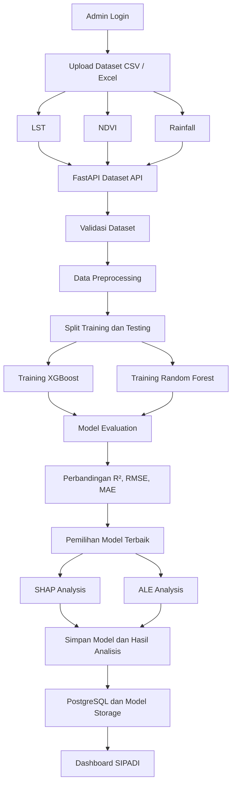

# Product Requirements Document (PRD) — Sistem Terintegrasi SIPADI (Full-Stack & ML Pipeline)

**Versi:** 3.0  
**Fokus:** Arsitektur Sistem Terintegrasi End-to-End (Frontend UI, Backend FastAPI, Machine Learning XGBoost vs Random Forest, XAI SHAP & ALE, PostgreSQL, dan Model Storage)  
**Status:** Integrasi Full-Stack & Otomasi Pipeline Machine Learning

---

## 1. Ringkasan

SIPADI (Sistem Pemantauan dan Analisis Produktivitas Padi Berbasis AI) adalah platform analitik terintegrasi untuk memantau produktivitas padi, memprediksi hasil panen berbasis data penginderaan jauh dan agroklimat, serta menjelaskan faktor-faktor lingkungan yang memengaruhi estimasi menggunakan pendekatan Explainable Artificial Intelligence (XAI).

Sistem berevolusi dari prototipe antarmuka frontend (v2.0) menjadi **sistem end-to-end terintegrasi penuh (v3.0)** yang mencakup:
1. **Frontend Interaktif (React + Vite + Tailwind CSS):** Antarmuka publik (Homepage) dan dashboard pengguna (Monitoring Produktivitas, Explainable Analysis, Insight Spasial, Simulasi Prediksi Kustom, serta Admin Dataset & Model).
2. **Backend API (FastAPI):** Layanan backend Python berkinerja tinggi untuk autentikasi admin, penerimaan dataset tabular, orkestrasi pelatihan model, komputasi metrik evaluasi, serta inferensi waktu-nyata (real-time).
3. **Automated Machine Learning Engine:** Validasi data input, prapemrosesan otomatis, dual-training paralel regresi **XGBoost** dan **Random Forest**, komparasi metrik ($R^2$, $RMSE$, $MAE$), serta seleksi model terbaik secara otonom.
4. **Explainable AI (XAI) Engine:** Ekstraksi atribusi fitur global/lokal menggunakan **SHAP (TreeExplainer)** dan analisis isolasi pengaruh nonlinier menggunakan **ALE (Accumulated Local Effects)**.
5. **Persistence Layer:** Penyimpanan terstruktur metadata dan hasil analisis menggunakan **PostgreSQL**, serta penyimpanan biner model serial (`.joblib`) pada media penyimpanan model (*Model Storage*).

## 2. Tujuan

- Mengimplementasikan UI yang konsisten dengan empat desain halaman SIPADI.
- Membuat alur navigasi yang berfungsi di sisi frontend.
- Menyediakan halaman Login dan Register sebagai bagian dari alur pengguna.
- Menampilkan kartu metrik, grafik, peta ilustratif, tabel atau ringkasan, dan informasi penjelas.
- Membuat filter, tab, tombol, menu, dan kontrol lain memberikan respons UI yang sesuai.
- Menggunakan mock data terpusat agar konten dapat diganti dengan respons API di kemudian hari.
- Menjaga pemisahan antara komponen UI, data, dan logika presentasi agar siap diintegrasikan dengan backend.

## 3. Batasan Ruang Lingkup

### 3.1 Termasuk dalam Lingkup Sistem Terintegrasi (v3.0)

- **Frontend & Visualisasi:**
  - Implementasi seluruh halaman dan layout frontend (Homepage, Monitoring, Analysis, Insight, Prediction Model, Admin, About, Login, Register).
  - Responsive layout untuk desktop, tablet, dan mobile.
  - Komponen peta lahan interaktif, grafik tren, grafik kontribusi SHAP, dan kurva efek ALE.
  - Halaman Admin Dataset (`/dashboard/admin`) untuk mengunggah CSV/Excel, memantau metrik komparasi model, dan mempublikasikan hasil.
  - Lapisan abstraksi API (`apiService.ts`) dengan kemampuan beralih otomatis antara live API FastAPI dan fallback mock data.
- **Backend & Otomasi Machine Learning (FastAPI):**
  - Autentikasi dan otorisasi Admin Login via API.
  - Endpoint penerimaan dataset tabular CSV/Excel (`/api/admin/datasets/upload`).
  - Mesin validasi skema dan rentang batas data fisik (NDVI, LST, Curah Hujan, Produktivitas).
  - Prapemrosesan data (imputasi missing values, koersi numerik).
  - Pembagian dataset (Train/Test Split 80:20).
  - Pelatihan model paralel: **XGBoost Regressor** dan **Random Forest Regressor**.
  - Evaluasi metrik komparatif: Koefisien Determinasi ($R^2$), Root Mean Squared Error ($RMSE$), dan Mean Absolute Error ($MAE$).
  - Seleksi otomatis model terbaik berdasarkan performa $R^2$ pengujian tertinggi.
  - Pipeline Explainable AI: kalkulasi nilai atribusi kepentingan fitur via **SHAP** dan kurva respons isolasi nonlinier via **ALE**.
  - Endpoint penyajian inferensi prediksi kustom (`POST /api/predict`).
  - Endpoint riwayat dan status model terkini (`GET /api/runs/latest`, `GET /api/runs/{run_id}`).
- **Penyimpanan Data (Persistence Layer):**
  - Basis data relasional **PostgreSQL** untuk menyimpan metadata pelatihan, log metrik, riwayat upload, dan akun pengguna.
  - Penyimpanan berkas model serial (*Model Storage*) biner `.joblib`.

### 3.2 Di luar Ruang Lingkup Saat Ini
- Pemrosesan data mentah citra satelit langsung (GEE raster ingestion on-the-fly) — input data ke sistem difokuskan pada dataset tabular CSV/Excel yang telah diekstraksi.
- Pengiriman notifikasi SMS/WhatsApp massal ke kelompok tani di luar platform web.

## 4. Target Pengguna

| Pengguna | Kebutuhan UI |
|---|---|
| Pengunjung | Memahami SIPADI dan menemukan tombol Login/Register. |
| Pengguna demo | Mencoba alur masuk dan menjelajahi dashboard. |
| Analis atau peneliti | Melihat indikator, grafik, SHAP, ALE, dan ringkasan insight. |
| Pengembang backend berikutnya | Memahami bentuk data dan titik integrasi yang disiapkan frontend. |

## 5. Peta Halaman dan Navigasi

| Halaman | URL yang disarankan | Akses UI | Peran Utama |
|---|---|---|---|
| Homepage | `/` | Publik | Edukasi publik, landing page, dan akses login |
| Login | `/login` | Publik / Admin | Otentikasi pengguna & kredensial administrator |
| Register | `/register` | Publik | Pendaftaran akun baru |
| Monitoring | `/dashboard/monitoring` | Login diperlukan | Analitik spasial agroklimat dan tren produktivitas |
| Explainable Analysis | `/dashboard/analysis` | Login diperlukan | Interpretasi kontribusi fitur (SHAP) dan isolasi efek (ALE) |
| Insight Produktivitas | `/dashboard/insight` | Login diperlukan | Peta lahan spasial dan estimasi produktivitas per wilayah |
| Simulasi Prediksi | `/dashboard/prediction-model` | Login diperlukan | Pengujian parameter kustom ke model ML aktif |
| Admin Dataset | `/dashboard/admin` | Khusus Admin | Upload CSV/Excel, trigger training ML, seleksi model, dan XAI |
| Tentang Sistem | `/dashboard/about` atau `/about` | Login / Publik | Metodologi AI, sumber data, dan profil tim pengembang |

Nama URL dapat disesuaikan dengan framework, tetapi struktur navigasi sebaiknya konsisten.

### 5.1 Alur pengguna

**Pengunjung baru**
1. Membuka Homepage.
2. Memilih Register.
3. Mengisi formulir dan melihat validasi frontend.
4. Setelah simulasi registrasi berhasil, diarahkan ke Login.
5. Melakukan simulasi login.
6. Masuk ke halaman Monitoring.

**Pengguna yang sudah memiliki akun**
1. Membuka Login.
2. Mengisi kredensial demo.
3. Melihat status berhasil/gagal sesuai aturan simulasi.
4. Setelah berhasil, diarahkan ke dashboard.
5. Menjelajahi Monitoring, Analysis, Insight, dan Tentang.
6. Memilih Logout untuk mengakhiri sesi demo dan kembali ke Homepage.

### 5.2 Perilaku route pada frontend

- Pengunjung dapat membuka Homepage, Login, dan Register tanpa login.
- Jika pengguna demo belum login lalu membuka route dashboard, tampilkan redirect ke Login.
- Jika login simulasi berhasil, arahkan pengguna ke halaman yang diminta sebelumnya atau Monitoring.
- Jika pengguna melakukan logout, ubah status UI menjadi belum login dan arahkan ke Homepage.
- Jangan menyimpan kata sandi pengguna. Untuk demo, gunakan mekanisme simulasi yang aman dan sederhana.
- Implementasi ini bukan pengganti autentikasi backend.

---

## 6. Spesifikasi UI — Homepage

### 6.1 Tujuan

Memperkenalkan SIPADI, menjelaskan manfaatnya, memberi gambaran alur kerja, serta mengarahkan pengguna ke Login/Register atau dashboard.

### 6.2 Bagian halaman

1. **Navbar**
   - Logo SIPADI.
   - Beranda, Monitoring, Analysis, Insight, Tentang Sistem.
   - Tombol Login dan Register untuk pengunjung.
   - Tombol Buka Dashboard jika status login demo aktif.

2. **Hero section**
   - Headline tentang pemantauan produktivitas tanaman dan faktor lingkungan.
   - Deskripsi singkat SIPADI.
   - CTA untuk mulai menjelajahi monitoring.
   - CTA sekunder untuk mempelajari alur sistem.
   - Visual lanskap sawah/satelit sesuai desain referensi.

3. **Ringkasan metrik**
   - NDVI.
   - LST.
   - Curah hujan.
   - Estimasi produktivitas.
   - Seluruh angka pada tahap frontend ditampilkan sebagai data contoh dan diberi penanda yang sesuai jika berpotensi disalahartikan sebagai data aktual.

4. **Alur kerja SIPADI**
   - Akuisisi data.
   - Harmonisasi spasial.
   - Komputasi prediktif.
   - Explainable AI.

5. **Preview analitik**
   - Preview peta petak sawah.
   - Preview kontribusi SHAP.
   - Preview kurva ALE.

6. **Aksesibilitas platform**
   - Kartu menuju Monitoring Spasial, Analisis Prediktif, Insight Multivariat, dan Tentang Sistem.

7. **CTA akhir dan footer**
   - Ajakan membuka dashboard.
   - Informasi ringkas platform, metodologi, dan riset.

### 6.3 Interaksi

- Tombol Login membuka `/login`.
- Tombol Register membuka `/register`.
- CTA dashboard membuka Monitoring jika status login demo aktif; jika belum, membuka Login.
- Navbar dapat menggulir ke bagian terkait atau berpindah ke route yang sesuai.
- Kartu preview dapat menjadi tautan ke halaman terkait, dengan pemeriksaan status login demo.

### 6.4 Kriteria penerimaan

- Semua bagian utama Homepage tersedia dan tersusun sesuai desain.
- Navbar dan CTA dapat digunakan.
- Pengunjung dapat membuka halaman Login/Register.
- Data contoh tidak diklaim sebagai data aktual.
- Layout menyesuaikan ukuran layar.

---

## 7. Spesifikasi UI — Login

### 7.1 Tujuan

Menyediakan tampilan untuk pengguna memasukkan kredensial dan melihat hasil simulasi login sebelum integrasi autentikasi backend.

### 7.2 Elemen UI

- Logo dan nama SIPADI.
- Judul dan deskripsi singkat.
- Input email.
- Input kata sandi dengan kontrol tampil/sembunyikan.
- Tombol Masuk.
- Tautan ke Register.
- Tautan Lupa Kata Sandi sebagai UI saja jika ditampilkan.
- Pesan validasi, status loading, pesan gagal, dan pesan berhasil.
- Tautan kembali ke Homepage.

### 7.3 Perilaku frontend

- Validasi kolom wajib dan format email.
- Konfirmasi kata sandi tidak diperlukan di halaman Login.
- Tombol Masuk menunjukkan loading sementara.
- Untuk demo, hasil login boleh menggunakan aturan mock yang terdokumentasi atau tombol mode demo.
- Login berhasil mengubah status autentikasi frontend dan membuka dashboard.
- Login gagal menampilkan pesan umum tanpa mengekspos informasi sensitif.
- Jangan mengirim atau menyimpan kredensial ke layanan eksternal pada tahap ini.

### 7.4 Kriteria penerimaan

- Input dapat digunakan dan divalidasi.
- Tombol tampil/sembunyikan kata sandi bekerja.
- Status loading dan pesan error dapat terlihat.
- Simulasi login berhasil membawa pengguna ke dashboard.
- Tautan Register membuka halaman registrasi.
- UI login dapat nantinya dihubungkan ke fungsi autentikasi tanpa mengubah layout utama.

---

## 8. Spesifikasi UI — Register

### 8.1 Tujuan

Menyediakan antarmuka pembuatan akun dengan validasi dasar di sisi klien.

### 8.2 Elemen UI

- Logo SIPADI.
- Input nama lengkap.
- Input email.
- Input kata sandi.
- Input konfirmasi kata sandi.
- Kontrol tampil/sembunyikan kata sandi.
- Checkbox persetujuan ketentuan/privasi jika diperlukan.
- Tombol Daftar.
- Tautan ke Login.
- Pesan validasi dan hasil simulasi registrasi.

### 8.3 Perilaku frontend

- Memvalidasi kolom wajib.
- Memvalidasi format email.
- Memastikan kata sandi dan konfirmasi kata sandi cocok.
- Menampilkan aturan kata sandi secara jelas.
- Menampilkan status loading saat submit simulasi.
- Setelah simulasi berhasil, tampilkan pesan berhasil dan arahkan pengguna ke Login.
- Tidak membuat akun sungguhan atau menyimpan data ke database pada tahap ini.

### 8.4 Kriteria penerimaan

- Seluruh input dan checkbox bekerja.
- Validasi muncul dekat dengan field yang relevan.
- Tombol Daftar memberi respons visual.
- Registrasi demo tidak diklaim sebagai pembuatan akun produksi.
- UI siap menerima respons dari API registrasi pada tahap berikutnya.

---

## 9. Layout Dashboard Bersama

### 9.1 Elemen global

- Sidebar hijau tua dengan logo SIPADI.
- Menu Monitoring, Analysis, Insight, dan Tentang.
- Header dengan filter Wilayah dan Tahun.
- Avatar atau menu profil.
- Tombol Ekspor pada halaman yang memerlukannya.
- Indikator halaman aktif.
- Area konten utama dengan judul, deskripsi, kartu, dan visualisasi.

### 9.2 Filter global

- Dropdown Wilayah, contoh pilihan: Tabanan, Badung, Gianyar.
- Dropdown Tahun, dengan pilihan tahun yang tersedia di mock data.
- Perubahan filter memperbarui komponen yang terhubung menggunakan mock data.
- Pilihan filter sebaiknya dipertahankan saat berpindah halaman jika memungkinkan.
- Jika kombinasi wilayah/tahun belum memiliki data, tampilkan empty state dan jangan menampilkan nilai yang menyesatkan.

### 9.3 Menu akun

- Menampilkan avatar/inisial pengguna demo.
- Menyediakan opsi Logout.
- Jika diperlukan, tampilkan nama pengguna demo.
- Jangan menampilkan informasi akun sensitif.

---

## 10. Spesifikasi UI — Monitoring Produktivitas

### 10.1 Tujuan

Memberikan gambaran cepat tentang estimasi produktivitas dan indikator lingkungan, serta tren produktivitas dari tahun ke tahun.

### 10.2 Komponen

1. **Judul halaman dan deskripsi**
   - “Monitoring Produktivitas”.
   - Deskripsi singkat mengenai indikator agroklimat dan estimasi produktivitas.

2. **Kartu metrik**
   - Produktivitas (ton/ha).
   - NDVI.
   - LST (°C).
   - Curah hujan (mm).
   - Masing-masing menampilkan nilai, satuan, status, dan keterangan singkat bila tersedia.

3. **Grafik tren produktivitas**
   - Grafik garis per tahun.
   - Label nilai pada titik penting.
   - Tooltip berisi tahun dan nilai.
   - Legenda yang membedakan realisasi dan estimasi jika keduanya ditampilkan.
   - Sumbu dan satuan yang jelas.

4. **Faktor prediksi**
   - Bar indikator seperti NDVI, Curah Hujan, dan LST.
   - Menampilkan nilai/bobot yang sesuai dengan definisi data mock.
   - Label harus menjelaskan apakah angka merupakan feature importance, persentase, atau metrik lain.

5. **Ekspor**
   - Tombol Ekspor.
   - Pada tahap frontend, tombol boleh membuka pilihan format atau mengunduh file contoh statis jika mudah.
   - Tidak perlu membuat proses pelaporan backend.

### 10.3 Interaksi

- Filter wilayah dan tahun memperbarui kartu serta grafik mock.
- Tooltip grafik aktif.
- Tombol Ekspor memberikan feedback UI yang jelas.
- Status loading/error/empty dapat didemonstrasikan melalui state komponen.

### 10.4 Kriteria penerimaan

- Kartu dan grafik konsisten dengan filter mock.
- Satuan dan label terlihat.
- Visualisasi dapat digunakan dengan mouse dan keyboard sejauh didukung library.
- Tampilan tetap terbaca di layar kecil.

---

## 11. Spesifikasi UI — Explainable Analysis

### 11.1 Tujuan

Menampilkan UI untuk memahami kontribusi indikator terhadap prediksi melalui SHAP dan pola respons prediksi melalui ALE. Perhitungan analisis belum dibuat pada tahap ini.

### 11.2 Bagian SHAP

- Judul bagian SHAP dan penjelasan singkat.
- Bar kontribusi untuk Curah Hujan, NDVI, dan LST.
- Nilai mean absolute SHAP atau nilai SHAP ditampilkan sesuai jenis data contoh yang dipilih.
- Bar positif dan negatif dibedakan dengan warna serta label.
- Baseline ditampilkan jika visualisasi memerlukan baseline.
- Keterangan singkat tentang arti nilai dan batas interpretasi.

**Ketentuan UI:** jangan mencampuradukkan mean absolute SHAP dengan SHAP bertanda. Mock data harus mengikuti jenis visualisasi yang ditampilkan.

### 11.3 Bagian ALE

- Judul dan deskripsi hubungan indikator dengan prediksi.
- Tab/pemilih fitur: NDVI, LST, Curah Hujan.
- Grafik garis respons ALE.
- Label sumbu dan satuan.
- Garis referensi baseline nol.
- Penanda nilai observasi atau titik kritis jika tersedia di mock data.
- Tooltip untuk nilai fitur dan efek.
- Ringkasan nilai fitur terpilih.

### 11.4 Interaksi

- Pemilihan tab mengganti grafik dan deskripsi mock.
- Tooltip menampilkan detail titik.
- Nilai ringkasan mengikuti fitur terpilih.
- Filter wilayah dan tahun memperbarui mock data terkait.

### 11.5 Kriteria penerimaan

- SHAP dan ALE dapat dibedakan secara visual dan tekstual.
- Tab fitur bekerja.
- Grafik memiliki label, satuan, dan tooltip.
- UI tidak mengklaim bahwa perhitungan SHAP/ALE sungguhan sudah dilakukan.
- Struktur komponen memungkinkan data grafik diganti dengan respons backend nanti.

---

## 12. Spesifikasi UI — Insight Produktivitas

### 12.1 Tujuan

Merangkum estimasi produktivitas, kontribusi indikator, pola hubungan, dan gambaran spasial dalam bentuk yang mudah dibaca.

### 12.2 Komponen

1. **Kartu prediksi utama**
   - Nilai produktivitas dan satuan.
   - Label periode dan wilayah.
   - Perbandingan dengan rerata atau baseline jika data contoh menyediakan pembanding.
   - Status estimasi sebagai contoh jika belum terhubung ke data aktual.

2. **Status sintesis panen**
   - Kategori seperti rendah, optimum, atau tinggi.
   - Indikator visual/range.
   - Keterangan ambang yang digunakan pada mock data.

3. **Ringkasan insight**
   - Kontributor utama.
   - Karakteristik hubungan model.
   - Indikator dengan kontribusi negatif.
   - Masing-masing berupa kartu dengan deskripsi singkat dan angka contoh.

4. **Kontribusi setiap indikator**
   - Grafik bar untuk NDVI, curah hujan, dan LST.
   - Penjelasan metrik yang digunakan.

5. **Pola hubungan indikator**
   - Grafik respons kecil.
   - Tab NDVI, LST, dan Curah Hujan.

6. **Peta prediksi produktivitas**
   - Peta ilustratif atau mock petak sawah.
   - Legenda kategori produktivitas.
   - Tooltip petak jika memungkinkan.
   - Label bahwa peta adalah ilustrasi/mock data apabila belum menggunakan data geospasial sebenarnya.

### 12.3 Interaksi

- Tab indikator mengganti grafik.
- Hover pada grafik atau petak menampilkan tooltip.
- Filter wilayah/tahun mengubah mock data.
- Kartu dapat menyediakan tautan ke halaman Analysis untuk detail pendukung.

### 12.4 Kriteria penerimaan

- Angka ringkasan dan grafik konsisten dengan mock data.
- Kategori memiliki legenda dan keterangan.
- Peta memiliki penanda data ilustratif.
- UI tidak menyajikan angka contoh sebagai hasil model yang sudah tervalidasi.

---

## 13. Spesifikasi UI — Tentang Sistem

Halaman Tentang dapat dibuat sebagai halaman sederhana yang mengikuti identitas visual SIPADI.

### Komponen yang disarankan

- Ringkasan tujuan SIPADI.
- Penjelasan singkat sumber indikator: NDVI, LST, dan curah hujan.
- Ringkasan alur kerja data.
- Penjelasan model prediktif dan XAI pada tingkat konseptual.
- Catatan keterbatasan dan status prototipe.
- Informasi versi aplikasi atau tim jika diperlukan.

Halaman ini bersifat informatif dan tidak membutuhkan integrasi backend pada tahap frontend.

---

## 14. Strategi Mock Data dan Kesiapan Integrasi Backend

### 14.1 Prinsip

- Simpan mock data di folder terpisah dari komponen presentasi.
- Hindari menulis angka contoh langsung di banyak komponen.
- Gunakan struktur data yang mudah dipetakan ke respons API.
- Gunakan fungsi data/service layer sebagai titik penghubung di masa depan.
- Komponen UI menerima data melalui props atau state, bukan mengambil data langsung di banyak tempat.
- Tandai mock data secara konsisten agar tidak disangka data aktual.

### 14.2 Contoh struktur mock data

```ts
type MonitoringSummary = {
  regionId: string;
  year: number;
  productivity: {
    value: number;
    unit: "ton/ha";
    type: "actual" | "estimate" | "mock";
  };
  ndvi: {
    value: number;
    status?: string;
  };
  lst: {
    value: number;
    unit: "°C";
  };
  rainfall: {
    value: number;
    unit: "mm";
    periodLabel: string;
  };
};
```

Contoh ini hanya kontrak data frontend. Bentuk final dapat disesuaikan saat API backend dirancang.

### 14.3 Lapisan data yang disarankan

```text
src/
  components/       # Komponen UI yang dapat digunakan ulang
  layouts/          # Layout publik dan dashboard
  pages/            # Homepage, Login, Register, Monitoring, Analysis, Insight
  routes/           # Konfigurasi route dan route guard demo
  services/         # Fungsi akses data; saat ini menggunakan mock
  mocks/            # Data contoh untuk seluruh halaman
  types/            # Tipe data dan kontrak frontend
  hooks/            # Hook state/filter yang digunakan bersama
  assets/           # Logo, ikon, dan gambar
  styles/           # Token warna, tipografi, dan styling global
```

Struktur ini merupakan rekomendasi, bukan kewajiban framework tertentu.

### 14.4 Kontrak integrasi masa depan

Ketika backend tersedia:
- Fungsi pada `services/` diganti atau dilengkapi dengan pemanggilan API.
- Bentuk data dari API dipetakan ke tipe frontend.
- Komponen presentasi tetap digunakan selama kontrak data tidak berubah secara mendasar.
- Status loading, error, empty, dan sukses tetap dipakai.
- Simulasi login diganti dengan autentikasi sungguhan.
- Route guard demo diganti/dilengkapi dengan status autentikasi nyata; backend tetap menjadi pihak yang memvalidasi akses.

---

## 15. Design System dan Komponen Reusable

### 15.1 Arah visual

Ikuti desain referensi yang diberikan:
- Hijau tua sebagai warna utama sidebar dan elemen identitas.
- Hijau sedang untuk aksi utama, status positif, dan menu aktif.
- Latar krem/putih hangat.
- Border tipis dengan warna netral hangat.
- Biru untuk curah hujan.
- Hijau untuk NDVI.
- Koral/merah untuk kontribusi negatif.
- Kuning/emas untuk kategori peringatan.
- Sudut kartu membulat, bayangan ringan, dan ruang antarbagian yang konsisten.

Pastikan kontras teks memadai. Jangan hanya mengandalkan warna untuk membedakan status; sertakan label atau ikon.

### 15.2 Komponen reusable

- `AppSidebar`
- `AppHeader`
- `PageTitle`
- `RegionSelect`
- `YearSelect`
- `MetricCard`
- `StatusBadge`
- `ChartCard`
- `ShapContributionChart`
- `AleResponseChart`
- `ProductivityMap`
- `InsightCard`
- `EmptyState`
- `ErrorState`
- `LoadingSkeleton`
- `LoginForm`
- `RegisterForm`
- `PasswordInput`
- `UserMenu`
- `ExportButton`

Nama dapat menyesuaikan konvensi proyek.

### 15.3 Responsive design

- Desktop: sidebar tetap dan area konten utama luas.
- Tablet: sidebar dapat dipersempit atau diubah menjadi drawer.
- Mobile: navigasi menjadi menu yang mudah dibuka, filter disusun vertikal, kartu menjadi satu kolom, dan grafik tetap dapat dibaca.
- Tabel, grafik, dan peta harus memiliki perilaku overflow yang terkontrol.
- Hindari ukuran teks yang terlalu kecil untuk label dan legenda.

---

## 16. State UI yang Wajib Disiapkan

Untuk komponen yang menampilkan data, siapkan variasi berikut meskipun pada awalnya menggunakan simulasi:

- **Loading:** skeleton atau indikator proses.
- **Success:** data berhasil ditampilkan.
- **Empty:** tidak ada data untuk filter terpilih.
- **Error:** data gagal dimuat.
- **Mock/Demo:** data bersifat ilustratif.
- **Disabled:** aksi belum tersedia.
- **Unauthenticated:** pengguna perlu login.
- **Form validation:** input belum valid.
- **Submitting:** form sedang diproses.
- **Success feedback:** aksi berhasil dalam simulasi.

State ini akan memudahkan penggantian mock data dengan API tanpa perlu merombak seluruh tampilan.

---

## 17. Kebutuhan Nonfungsional Frontend

| Aspek | Persyaratan |
|---|---|
| Responsivitas | Halaman utama berfungsi pada desktop, tablet, dan mobile. |
| Konsistensi | Warna, tipografi, jarak, tombol, dan kartu menggunakan aturan desain yang konsisten. |
| Performa UI | Hindari render ulang yang tidak perlu; grafik berat dapat dimuat sesuai kebutuhan. |
| Aksesibilitas | Input memiliki label; tombol dan menu dapat digunakan dengan keyboard; status tidak hanya dibedakan dengan warna. |
| Maintainability | Komponen reusable dan data terpisah dari presentasi. |
| Type safety | Jika memakai TypeScript, definisikan tipe data untuk metrik dan respons grafik. |
| Penanganan error | Error dan data kosong memiliki tampilan yang terarah. |
| Browser | Mendukung browser desktop modern yang ditetapkan untuk proyek. |
| Keamanan demo | Jangan menyimpan kata sandi atau mengklaim route guard frontend sebagai proteksi keamanan produksi. |
| Integrasi | Pemanggilan data diarahkan melalui service layer agar mudah diganti dengan API. |

---

## 18. Prioritas Implementasi Frontend

### P0 — Wajib untuk demo UI

- [ ] Design tokens dan layout dasar.
- [ ] Homepage sesuai desain.
- [ ] Login dan Register.
- [ ] Navigasi dan simulasi login/logout.
- [ ] Layout dashboard dan sidebar.
- [ ] Filter wilayah/tahun dengan mock data.
- [ ] Halaman Monitoring dan grafik tren.
- [ ] Halaman Explainable Analysis dengan SHAP dan ALE mock.
- [ ] Halaman Insight Produktivitas.
- [ ] Halaman Tentang.
- [ ] Loading, empty, error, dan validasi formulir.
- [ ] Responsive layout.
- [ ] Penanda data contoh/mock.

### P1 — Penyempurnaan UI

- [ ] Tooltip dan interaksi grafik.
- [ ] Peta ilustratif dengan tooltip petak.
- [ ] Tombol ekspor simulasi.
- [ ] Persistensi filter selama navigasi.
- [ ] Animasi ringan dan transisi antarstate.
- [ ] Pengujian aksesibilitas dan responsivitas.

### P2 — Persiapan integrasi

- [ ] Tipe data dan kontrak frontend.
- [ ] Service layer untuk mock data.
- [ ] Dokumentasi titik pemanggilan API.
- [ ] Konfigurasi environment untuk URL API di masa depan.
- [ ] Pemisahan mekanisme autentikasi dari komponen formulir.

---

## 19. Kriteria Penerimaan Keseluruhan

- [ ] Seluruh halaman yang disepakati tersedia dan dapat dinavigasi.
- [ ] Tampilan mengikuti referensi visual SIPADI.
- [ ] Pengunjung dapat membuka Homepage tanpa login.
- [ ] Login dan Register memiliki validasi frontend.
- [ ] Simulasi login mengizinkan pengguna demo masuk ke dashboard.
- [ ] Route dashboard mengarahkan pengguna yang belum login ke Login.
- [ ] Logout mengembalikan status UI menjadi belum login.
- [ ] Seluruh kartu dan grafik menggunakan mock data terpusat.
- [ ] Filter wilayah/tahun mengubah tampilan sesuai mock data.
- [ ] SHAP, ALE, dan peta hanya divisualisasikan menggunakan data contoh pada tahap ini.
- [ ] Loading, empty, error, dan form validation state tersedia.
- [ ] Layout dapat digunakan pada desktop, tablet, dan mobile.
- [ ] Komponen tidak terikat langsung pada satu sumber data sehingga dapat menerima data dari API nanti.
- [ ] Tidak ada klaim bahwa backend, autentikasi produksi, atau model prediktif telah diimplementasikan.

---

## 20. Tahapan Pengerjaan yang Disarankan

1. **Fondasi UI**
   - Siapkan project, routing, font, warna, token desain, dan komponen dasar.

2. **Homepage dan autentikasi**
   - Implementasikan Homepage, Login, Register, validasi, dan simulasi alur pengguna.

3. **Layout dashboard**
   - Implementasikan sidebar, header, filter global, menu akun, dan route guard demo.

4. **Halaman Monitoring**
   - Buat kartu metrik, grafik tren, faktor prediksi, dan tombol ekspor simulasi.

5. **Halaman Explainable Analysis**
   - Buat grafik SHAP, pemilih fitur ALE, grafik respons, dan tooltip.

6. **Halaman Insight**
   - Buat kartu ringkasan, grafik kontribusi, grafik respons, dan peta ilustratif.

7. **Halaman Tentang dan responsive refinement**
   - Lengkapi konten informatif, tampilan mobile, dan state UI.

8. **Validasi frontend**
   - Uji seluruh route, form, filter, tooltip, state kosong/error, dan logout.
   - Pastikan tidak ada ketergantungan pada backend sungguhan.

9. **Persiapan integrasi**
   - Dokumentasikan tipe data dan service layer yang nanti akan dihubungkan ke API.

---

---

## 21. Arsitektur Sistem Terintegrasi End-to-End

Arsitektur sistem dibangun secara ketat mengikuti alur kerja pemrosesan data, pelatihan model ganda, evaluasi komparatif, analisis keberterimaan AI (XAI), hingga penyajian pada Dashboard SIPADI:



### 21.1 Tahapan Pemrosesan Alur Kerja:

1. **Admin Login:** Otentikasi dan otorisasi sesi administrator sebelum hak unggah dataset dan pemicuan pelatihan model dibuka.
2. **Upload Dataset CSV / Excel:** Admin mengunggah dataset tabular multi-dimensi yang memuat fitur utama:
   - **LST (Land Surface Temperature):** Suhu radiometrik permukaan tanah dari citra thermal satelit.
   - **NDVI (Normalized Difference Vegetation Index):** Indeks kehijauan dan kerapatan kanopi tanaman padi.
   - **Rainfall:** Akumulasi curah hujan bulanan/musiman (mm).
   - **Produktivitas:** Variabel target hasil panen aktual (kuintal/ha).
3. **FastAPI Dataset API:** Pintu gerbang API menerima berkas via multipart form upload, memverifikasi MIME-type, dan mengonversi data ke DataFrame pandas.
4. **Validasi Dataset:** Memastikan skema kolom terpenuhi (target dan fitur pendukung), mendeteksi tipe data non-numerik, memvalidasi rentang fisik nilai (NDVI antara $-1.0$ dan $1.0$, LST dalam rentang normal pertanian, Curah Hujan $\ge 0$), serta memastikan batas minimum baris valid terpenuhi.
5. **Data Preprocessing:** Imputasi nilai hilang (*missing values*) secara cermat, pembersihan nilai tak berhingga (*infinite values*), koersi tipe data numerik, serta normalisasi penamaan variabel fitur.
6. **Split Training dan Testing:** Pembagian data proporsional (80% data latih / 20% data uji) dengan penguncian seed acak (*random state*) untuk menjamin reproduktibilitas hasil evaluasi.
7. **Dual Model Training (Paralel):**
   - **XGBoost Regressor:** Algoritma berbasis Extreme Gradient Boosting yang mengoptimalkan fungsi tujuan secara bertahap dengan regularisasi.
   - **Random Forest Regressor:** Algoritma ensemble pohon keputusan yang menggunakan metode *bootstrap aggregating* (bagging) untuk mengurangi varians.
8. **Model Evaluation:** Pengujian performa inferensi kedua model pada subset data testing yang independen.
9. **Perbandingan Metrik Evaluasi:** Menghitung tiga metrik utama regresi:
   - Koefisien Determinasi ($R^2$): Proporsi varians target yang mampu dijelaskan model.
   - Root Mean Squared Error ($RMSE$): Penalti kuadratik kesalahan prediksi dalam satuan kuintal/ha.
   - Mean Absolute Error ($MAE$): Rata-rata absolut deviasi kesalahan prediksi.
10. **Pemilihan Model Terbaik:** Sistem membandingkan nilai $R^2$ pengujian; model dengan nilai $R^2$ tertinggi terpilih sebagai model juara (*best production model*).
11. **Explainable AI Pipeline:**
    - **SHAP Analysis:** Menggunakan algoritma `shap.TreeExplainer` untuk menghitung nilai atribusi marjinal Shapley pada seluruh baris data sampel.
    - **ALE (Accumulated Local Effects) Analysis:** Menghitung kurva pengaruh murni fitur terhadap prediksi dengan membagi distribusi variabel menjadi beberapa kuantil (*quantile bins*), mengisolasi efek tanpa bias korelasi antarfitur.
12. **Simpan Model dan Hasil Analisis:** Menyimpan biner model terlatih (`.joblib`) bersama skema fitur dan metadata waktu pembuatan.
13. **PostgreSQL dan Model Storage:**
    - **PostgreSQL:** Menyimpan metadata riwayat pelatihan (`training_runs`), metrik evaluasi komparatif, nilai SHAP fitur, data kurva titik ALE, serta catatan pengguna/admin.
    - **Model Storage:** Direktori penyimpanan aman atau media penyimpanan objek untuk berkas model serial (`.joblib`).
14. **Dashboard SIPADI:** Frontend web mengonsumsi API FastAPI untuk menyajikan metrik terkini, grafik SHAP waterfall/importance, kurva respons ALE, simulasi prediksi kustom, dan agregasi data spasial wilayah.

---

## 22. Spesifikasi Backend FastAPI & Kontrak API

Backend dikembangkan menggunakan Python 3.10+ dengan framework FastAPI dan Uvicorn.

### 22.1 Struktur Endpoint API

| Endpoint | Metode | Akses | Deskripsi & Respons |
|---|---|---|---|
| `/api/auth/login` | `POST` | Publik | Otentikasi admin, mengembalikan JWT Bearer token |
| `/api/admin/datasets/upload` | `POST` | Admin | Unggah CSV/Excel, validasi, latih XGBoost & RF, hitung SHAP & ALE, simpan hasil |
| `/api/runs/latest` | `GET` | Publik / User | Mengambil data model terbaik terkini, metrik komparasi, data SHAP, dan titik kurva ALE |
| `/api/runs/{run_id}` | `GET` | Publik / User | Mengambil arsip riwayat pelatihan model tertentu berdasarkan ID |
| `/api/predict` | `POST` | User | Menjalankan inferensi produktivitas padi secara langsung berdasarkan input LST, NDVI, Curah Hujan |
| `/api/monitoring/indicators` | `GET` | User | Mengambil ringkasan indikator spasial kabupaten & tren historis dari database |
| `/api/health` | `GET` | Publik | Healthcheck status API dan konektivitas basis data PostgreSQL |

### 22.2 Format Payload Unggah Dataset (`POST /api/admin/datasets/upload`)
- **Tipe Konten:** `multipart/form-data`
- **Parameter:**
  - `file`: Berkas biner (`.csv`, `.xlsx`, `.xls`).
  - `target` (opsional): Nama kolom target spesifik (default mendeteksi `Produktivitas`, `yield`, `production`).
- **Format Respons Sukses (HTTP 200):**
```json
{
  "id": "run-uuid-v4",
  "filename": "dataset_padi_bali_ML_2018_2025.csv",
  "rows": 847,
  "features": ["NDVI", "LST", "Rainfall"],
  "target": "Produktivitas",
  "best_model": "Random Forest",
  "metrics": {
    "XGBoost": { "r2": 0.1190, "rmse": 7.9772, "mae": 5.6443 },
    "Random Forest": { "r2": 0.1580, "rmse": 7.7988, "mae": 5.4869 }
  },
  "shap": [
    { "feature": "Rainfall", "importance": 1.4820, "displayName": "CURAH HUJAN" },
    { "feature": "NDVI", "importance": 0.9521, "displayName": "NDVI" },
    { "feature": "LST", "importance": 0.6214, "displayName": "LST" }
  ],
  "ale": {
    "NDVI": [ { "x": 0.42, "y": -1.2 }, { "x": 0.65, "y": 1.8 } ],
    "LST": [ { "x": 26.5, "y": 0.9 }, { "x": 31.2, "y": -1.4 } ],
    "Rainfall": [ { "x": 120, "y": -0.8 }, { "x": 450, "y": 1.1 } ]
  }
}
```

---

## 23. Spesifikasi Basis Data PostgreSQL

Sistem bertransisi dari penyimpanan SQLite lokal ke **PostgreSQL 15+** untuk menjamin konkurensi multi-user, integritas relasional, dan skalabilitas data spasial.

### 23.1 Skema Tabel Utama

1. **`users`**
   - `id` (UUID, Primary Key)
   - `name` (VARCHAR)
   - `email` (VARCHAR, Unique)
   - `hashed_password` (VARCHAR)
   - `role` (VARCHAR: `admin` | `analyst` | `viewer`)
   - `created_at` (TIMESTAMP)

2. **`training_runs`**
   - `id` (VARCHAR, Primary Key)
   - `filename` (VARCHAR)
   - `created_at` (TIMESTAMP)
   - `rows_count` (INTEGER)
   - `features` (JSONB)
   - `target_column` (VARCHAR)
   - `best_model` (VARCHAR)
   - `metrics` (JSONB)
   - `shap_data` (JSONB)
   - `ale_data` (JSONB)
   - `model_path` (VARCHAR)
   - `uploaded_by` (UUID, Foreign Key ke `users.id`)

3. **`dataset_records`**
   - `id` (BIGSERIAL, Primary Key)
   - `run_id` (VARCHAR, Foreign Key ke `training_runs.id`)
   - `region_name` (VARCHAR)
   - `year` (INTEGER)
   - `month` (INTEGER)
   - `ndvi` (DOUBLE PRECISION)
   - `lst` (DOUBLE PRECISION)
   - `rainfall` (DOUBLE PRECISION)
   - `productivity` (DOUBLE PRECISION)

---

## 24. Daftar Pekerjaan yang Harus Dilakukan (Action Items)

Berikut adalah daftar pekerjaan implementasi yang wajib diselesaikan untuk mewujudkan arsitektur sistem penuh:

### Fase 1: Konsolidasi Kode & Struktur Monorepo
- [ ] Pindahkan folder `backend/` dari `sc-sipadi/sc-sipadi/backend` ke direktori root workspace aktif [`web project/backend`](file:///c:/Users/iputu/Documents/Kuliah/Semester%205/Sistem%20Cerdas%20(B)/web%20project/backend).
- [ ] Pindahkan dan selaraskan komponen antarmuka [`AdminPage.tsx`](file:///c:/Users/iputu/Documents/Kuliah/Semester%205/Sistem%20Cerdas%20(B)/web%20project/src/pages/AdminPage.tsx) ke dalam direktori `src/pages/` di workspace aktif.
- [ ] Daftarkan route `/dashboard/admin` pada [`src/App.tsx`](file:///c:/Users/iputu/Documents/Kuliah/Semester%205/Sistem%20Cerdas%20(B)/web%20project/src/App.tsx) dan tambahkan menu navigasi "Admin Dataset" pada [`src/components/layout/AppSidebar.tsx`](file:///c:/Users/iputu/Documents/Kuliah/Semester%205/Sistem%20Cerdas%20(B)/web%20project/src/components/layout/AppSidebar.tsx).

### Fase 2: Peningkatan Pipeline Validasi & Machine Learning
- [ ] Implementasikan modul validasi dataset ketat di backend (`backend/validator.py`):
  - Validasi keberadaan kolom wajib (NDVI, LST, Curah Hujan, Produktivitas).
  - Validasi rentang nilai fisik: NDVI $[-1.0, 1.0]$, LST $[15.0, 45.0]$ °C, Rainfall $\ge 0$ mm, Produktivitas $> 0$.
  - Pelaporan detail kesalahan baris atau kolom yang tidak valid dalam format JSON terstruktur.
- [ ] Standarisasi pipeline evaluasi metrik ganda (XGBoost Regressor vs Random Forest Regressor) dengan output komparasi $R^2$, $RMSE$, dan $MAE$.
- [ ] Stabilisasi kalkulasi kurva respons ALE pada kuantil fitur serta ekstraksi nilai kepentingan SHAP TreeExplainer.

### Fase 3: Transisi & Integrasi Basis Data PostgreSQL
- [ ] Buat file konfigurasi koneksi basis data (`backend/database.py`) menggunakan SQLAlchemy dengan URI PostgreSQL yang dapat dikonfigurasi via file `.env` (dengan fallback otomatis ke SQLite untuk mode pengembangan lokal tanpa PostgreSQL).
- [ ] Implementasikan skema tabel PostgreSQL (`users`, `training_runs`, `dataset_records`).
- [ ] Pastikan biner model serial tersimpan rapi di direktori `backend/artifacts/` dengan penamaan terstruktur berbasis ID pelatihan.

### Fase 4: Autentikasi Admin & Proteksi Akses
- [ ] Buat skema otentikasi login admin menggunakan JWT (JSON Web Token) dengan hashing kata sandi (`passlib` / `bcrypt`).
- [ ] Tambahkan dependency security FastAPI (`Depends(get_current_admin)`) pada endpoint upload dataset `/api/admin/datasets/upload`.
- [ ] Hubungkan form Login di frontend untuk menyimpan token admin ke `localStorage` / React context.

### Fase 5: Integrasi Live API Frontend (`apiService.ts`)
- [ ] Perbarui [`src/services/apiService.ts`](file:///c:/Users/iputu/Documents/Kuliah/Semester%205/Sistem%20Cerdas%20(B)/web%20project/src/services/apiService.ts) untuk memanggil endpoint live:
  - `getShapData()` memanggil `/api/runs/latest`.
  - `getAleData()` memanggil `/api/runs/latest`.
  - `predictYield()` memanggil `POST /api/predict`.
- [ ] Tetapkan mekanisme graceful fallback ke mock data jika server backend sedang tidak berjalan (offline).
- [ ] Hubungkan formulir interaktif di `PredictionModelPage.tsx` langsung ke endpoint `/api/predict`.

---

## 25. Kesimpulan

Dengan integrasi arsitektur full-stack versi 3.0 ini, SIPADI tidak lagi sekadar prototipe antarmuka frontend, melainkan sebuah platform operasional kecerdasan buatan pertanian yang utuh. Setiap tahapan mulai dari unggah dataset penginderaan jauh, validasi kualitas data, kompetisi model XGBoost vs Random Forest, atribusi interpretabilitas SHAP & ALE, hingga persistensi pada PostgreSQL dan penyajian analitik di dashboard terangkai dalam satu alur kerja yang terstandarisasi, transparan, dan dapat diandalkan oleh para penyuluh, analis, dan kelompok tani.
