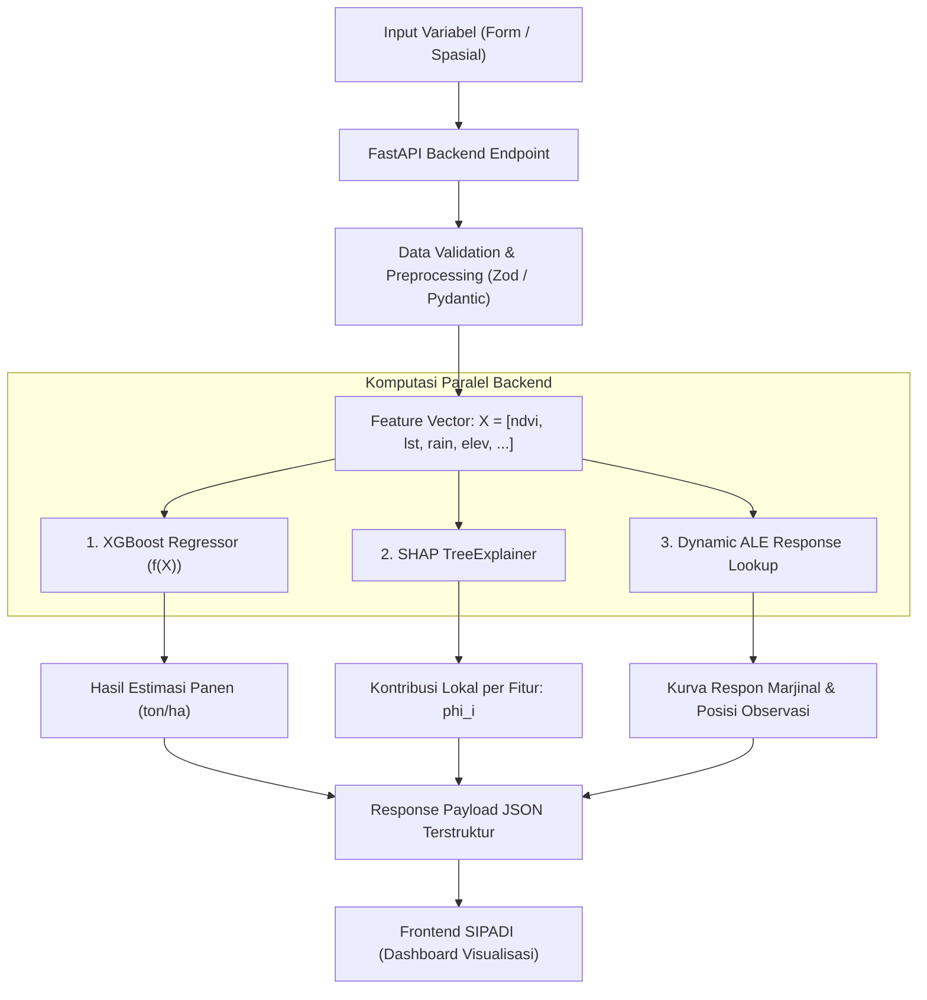

# Implementasi 10: Rencana & Arsitektur Input Data, Inferensi XGBoost, SHAP, dan ALE

Dokumen ini memuat **Rencana Implementasi (Implementation Plan)** komprehensif mengenai perancangan bentuk data input untuk variabel agroklimat dan geospasial, alur komputasi model *Machine Learning* (XGBoost), serta mekanisme kalkulasi interpretasi *Explainable AI* (XAI: SHAP dan ALE) pada ekosistem platform **SIPADI**.

---

## 1. Analisis Kebutuhan & Desain Bentuk Input

Dalam sistem prediksi pertanian cerdas berbasis penginderaan jauh (*remote sensing*) dan AI, bentuk input data perlu dirancang agar ramah pengguna (peneliti/penyuluh/petani) namun tetap presisi secara matematis bagi model *Machine Learning*. 

Terdapat **3 Modalitas Bentuk Input** yang direkomendasikan:

```
┌─────────────────────────────────────────────────────────────────────────────┐
│                       MODALITAS INPUT SISTEM SIPADI                        │
├──────────────────────────┬──────────────────────────┬───────────────────────┤
│ Mode 1: Form Simulasi    │ Mode 2: Koordinat Spasial│ Mode 3: Batch Upload  │
│ (Direct What-If Analysis)│ (Automated RS Extraction)│ (Multi-Parcel CSV)    │
├──────────────────────────┼──────────────────────────┼───────────────────────┤
│ Input manual angka fitur │ Input titik/poligon peta │ Unggah berkas CSV/    │
│ melalui slider/input box:│ + tanggal musim tanam.   │ GeoJSON kumpulan      │
│ • NDVI: 0.20 – 0.90      │ Backend mengekstrak      │ petak sawah sekaligus │
│ • LST: 20 – 38 °C        │ NDVI, LST, Curah Hujan   │ untuk evaluasi dinas  │
│ • Curah Hujan: mm/siklus │ otomatis via GEE API     │ kabupaten/provinsi.   │
│ • Elevasi & Varietas     │ atau data satelit raster │                       │
└──────────────────────────┴──────────────────────────┴───────────────────────┘
```

### 1.1 Variabel Fitur Prediktor yang Digunakan
Berdasarkan dokumen rancangan ilmiah SIPADI, terdapat 6 fitur utama penentu produktivitas padi (ton/ha):

| Nama Fitur | Simbol / Satuan | Tipe Data | Sumber Data Primer | Rentang Tipikal |
|---|---|---|---|---|
| **Normalized Difference Vegetation Index** | `ndvi` (indeks kanopi) | Float | Sentinel-2 MSI (Band 8 & Band 4) | `0.10` s.d `0.85` |
| **Land Surface Temperature** | `lst` (°C) | Float | Landsat-8/9 TIRS / MODIS / ERA5 | `20.0` s.d `38.0` °C |
| **Curah Hujan Musiman** | `rainfall` (mm/siklus) | Float | CHIRPS v2.0 (akumulasi ~115 hari) | `800` s.d `3500` mm |
| **Elevasi Topografi** | `elevation_m` (mdpl) | Float | SRTM DEM (resolusi 30m) | `50` s.d `1200` mdpl |
| **Varietas Benih Padi** | `variety` | Categorical / One-Hot | Data registrasi lapangan | `Beras Merah`, `Inpari 32`, `Ciherang` |
| **Wilayah Administratif** | `region_id` | Categorical | Batas administrasi kabupaten | `tabanan`, `badung`, `gianyar`, dll. |

---

## 2. Alur Komputasi Model (Inference, SHAP, & ALE)



### 2.1 Komputasi Prediksi XGBoost Regressor
- Model $f(X)$ yang telah dilatih diekspor dalam format binary ringan (`model.json` atau `model.joblib`).
- Waktu inferensi untuk satu vektor baris data sangat cepat: **< 5 milidetik**.
- Rumus inferensi: $\hat{y} = \sum_{k=1}^K f_k(X)$, menghasilkan prediksi bobot panen padi (ton/ha).

### 2.2 Komputasi Nilai SHAP (TreeExplainer)
- Menggunakan pustaka resmi `shap.TreeExplainer(model)`.
- Menguraikan estimasi akhir menjadi kontribusi aditif:
  $$\hat{y} = E[f(X)] + \sum_{i=1}^M \phi_i$$
  - $E[f(X)]$: Nilai rata-rata panen historis (*baseline*, misal 4.95 ton/ha).
  - $\phi_i$: Nilai SHAP fitur ke-$i$ (positif menambah hasil panen, negatif membatasi/menurunkan panen).
- TreeExplainer pada pohon XGBoost memiliki kompleksitas $O(TLD^2)$ yang dapat dieksekusi on-the-fly dalam **10 – 30 milidetik** per permintaan API.

### 2.3 Komputasi Nilai ALE (Accumulated Local Effects)
- **Karakteristik ALE:** Berbeda dengan SHAP yang bersifat instans lokal, ALE menghitung kurva efek isolasi non-linear terhadap populasi data secara keseluruhan tanpa bias korelasi antar-fitur.
- **Strategi Optimasi Sistem (Hybrid Pre-computation + Dynamic Point Marker):**
  1. **Offline Pre-computation:** Kurva ALE untuk seluruh rentang fitur (NDVI, LST, Curah Hujan) dihitung sekali pada dataset referensi saat training model selesai (menggunakan pustaka `PyALE` atau `alibi`). Hasilnya berupa grid data koordinat kurva yang disimpan dalam cache server / PostgreSQL.
  2. **Online Query:** Ketika user menginput data petak tertentu (misal NDVI = 0.68), backend langsung memetakan nilai 0.68 tersebut pada kurva ALE yang sudah ada (*observed value point*), sehingga respon API instan **< 5 milidetik**.

---

## 3. Desain Kontrak API & Skema Payload JSON

### 3.1 Request Payload (Frontend ke Backend)
Endpoint: `POST /api/v1/predict/inference`

```json
{
  "regionId": "tabanan",
  "fieldName": "Petak Sawah Jatiluwih Blok 3",
  "period": {
    "year": 2026,
    "plantingMonth": 5,
    "harvestMonth": 9
  },
  "features": {
    "ndvi": 0.68,
    "lst": 27.4,
    "rainfall": 1820.0,
    "elevationM": 650.0,
    "variety": "Beras Merah Jatiluwih"
  },
  "coordinates": {
    "latitude": -8.3688,
    "longitude": 115.1311
  }
}
```

### 3.2 Response Payload (Backend ke Frontend)
Payload yang dikembalikan langsung memetakan ke komponen visualisasi UI yang telah kita bangun:

```json
{
  "status": "success",
  "timestamp": "2026-10-27T03:30:00Z",
  "prediction": {
    "yieldTonHa": 5.21,
    "baselineTonHa": 4.95,
    "netDeviation": 0.26,
    "statusCategory": "Optimal",
    "confidenceScore": 0.94
  },
  "shapExplainer": {
    "baseValue": 4.95,
    "predictedValue": 5.21,
    "features": [
      {
        "id": "ndvi",
        "name": "NDVI (Indeks Kanopi)",
        "featureValue": "0.68",
        "shapValue": 0.42,
        "absoluteImpact": 0.42,
        "unit": "indeks",
        "interpretation": "Kanopi vegetasi lebat mendorong peningkatan panen secara signifikan (+0.42 ton/ha)."
      },
      {
        "id": "lst",
        "name": "Suhu Permukaan (LST)",
        "featureValue": "27.4 °C",
        "shapValue": -0.16,
        "absoluteImpact": 0.16,
        "unit": "°C",
        "interpretation": "Suhu permukaan sedikit di atas titik optimal menahan laju fotosintesis (-0.16 ton/ha)."
      },
      {
        "id": "rainfall",
        "name": "Curah Hujan Musiman",
        "featureValue": "1.820 mm",
        "shapValue": 0.12,
        "absoluteImpact": 0.12,
        "unit": "mm",
        "interpretation": "Pasokan air irigasi mencukupi kebutuhan fase generatif bulir padi (+0.12 ton/ha)."
      }
    ]
  },
  "aleReference": {
    "featureKey": "ndvi",
    "featureTitle": "NDVI Vegetasi Kanopi",
    "currentObservedValue": 0.68,
    "currentEffectTonHa": 0.38,
    "gridPoints": [
      {"featureValue": 0.2, "aleEffect": -0.65},
      {"featureValue": 0.4, "aleEffect": -0.22},
      {"featureValue": 0.6, "aleEffect": 0.15},
      {"featureValue": 0.68, "aleEffect": 0.38},
      {"featureValue": 0.8, "aleEffect": 0.52}
    ]
  },
  "recommendations": [
    "Pertahankan level genangan air irigasi minimal 3-5 cm untuk meredam suhu permukaan LST.",
    "Lakukan pemupukan susulan kalium spesifik pada blok yang memiliki NDVI < 0.60."
  ]
}
```

---

## 4. Implementation Plan (Rencana Pelaksanaan Bertahap)

Berikut adalah tahapan implementasi integrasi input, model inference, database, dan XAI:

```
┌─────────────────────────────────────────────────────────────────────────────┐
│                    ROADMAP IMPLEMENTASI END-TO-END SIPADI                   │
├─────────────────────────────────────────────────────────────────────────────┤
│                                                                             │
│ [FASE 1: Kesiapan Frontend & Kontrak Data]  ◄─── (STATUS: SELESAI)          │
│  ├── Desain UI/UX Lengkap (Monitoring, Analysis SHAP/ALE, Insight, Prediksi)│
│  ├── Mock Service Layer (apiService.ts & data.ts)                           │
│  └── Validasi Form Input & Client-side Simulation Storage (Local Storage)   │
│                                                                             │
│ [FASE 2: Backend Microservice (Python FastAPI)] ◄─── (LANGKAH BERIKUTNYA)   │
│  ├── Setup FastAPI App & CORS Integration ke Frontend Vite                  │
│  ├── Struktur Pydantic Schema untuk Validasi Payload Input                  │
│  └── Pemuatan Model Terlatih (xgboost.XGBRegressor.load_model)              │
│                                                                             │
│ [FASE 3: Komputasi SHAP TreeExplainer & ALE Pipeline]                       │
│  ├── Inisialisasi shap.TreeExplainer pada Model Terlatih                    │
│  ├── Pembuatan Engine Perhitungan SHAP Value Lokal per Request              │
│  └── Penyusunan Cache Kurva Respon ALE (PyALE / Alibi)                      │
│                                                                             │
│ [FASE 4: Integrasi Basis Data (PostgreSQL + PostGIS)]                       │
│  ├── Skema Tabel Petak Sawah, Riwayat Prediksi, dan Variabel Agroklimat     │
│  └── Relasi Spasial Geometris Polygon Sawah (PostGIS geometry ST_Polygon)   │
│                                                                             │
│ [FASE 5: Automasi Ingestion Data Satelit (Remote Sensing Integration)]      │
│  ├── Endpoint Ekstraksi Otomatis via Google Earth Engine (GEE Python API)   │
│  └── Pipeline Update Berkala Indeks NDVI Sentinel-2 & Presipitasi CHIRPS    │
│                                                                             │
└─────────────────────────────────────────────────────────────────────────────┘
```

### Rincian Rencana Tiap Fase:

#### Fase 1: Kesiapan Frontend & Kontrak Data (Selesai)
- Halaman formulir simulasi [`PredictionModelPage.tsx`](file:///c:/Users/iputu/Documents/Kuliah/Semester%205/Sistem%20Cerdas%20(B)/web%20project/src/pages/PredictionModelPage.tsx) telah siap menerima input `ndvi`, `lst`, `rainfall`, `variety`, `elevationM`.
- Visualisasi [`ShapContributionChart.tsx`](file:///c:/Users/iputu/Documents/Kuliah/Semester%205/Sistem%20Cerdas%20(B)/web%20project/src/components/charts/ShapContributionChart.tsx) dan [`AleResponseChart.tsx`](file:///c:/Users/iputu/Documents/Kuliah/Semester%205/Sistem%20Cerdas%20(B)/web%20project/src/components/charts/AleResponseChart.tsx) telah siap menyajikan data JSON tanpa perlu merombak UI.

#### Fase 2: Backend Microservice (Python FastAPI)
- Struktur repositori backend yang disarankan:
  ```
  backend/
  ├── app/
  │   ├── main.py                # FastAPI entry point
  │   ├── api/
  │   │   ├── predict.py         # Endpoint POST /predict
  │   │   ├── explain.py         # Endpoint GET /shap, GET /ale
  │   │   └── parcels.py         # Endpoint CRUD petak sawah
  │   ├── core/
  │   │   ├── config.py          # CORS & App Settings
  │   │   └── ml_engine.py       # Wrapper XGBoost & SHAP loader
  │   ├── models/
  │   │   └── trained_xgboost.json
  │   └── schemas/
  │       └── prediction.py      # Pydantic Input/Output models
  ├── requirements.txt
  └── Dockerfile
  ```
- Dependencies utama: `fastapi`, `uvicorn`, `xgboost`, `shap`, `pyale`, `numpy`, `pandas`, `pydantic`.

#### Fase 3: Komputasi SHAP TreeExplainer & ALE Pipeline
- Saat backend startup (`lifespan event`), muat model ke dalam memori:
  ```python
  model = xgb.XGBRegressor()
  model.load_model("app/models/trained_xgboost.json")
  explainer = shap.TreeExplainer(model)
  ```
- Endpoint kalkulasi:
  ```python
  @router.post("/predict/inference", response_model=PredictionResponse)
  def run_prediction(payload: PredictionInput):
      X_df = prepare_features(payload)
      y_pred = float(model.predict(X_df)[0])
      shap_vals = explainer.shap_values(X_df)[0]
      base_val = float(explainer.expected_value)
      
      return format_prediction_with_shap(y_pred, base_val, shap_vals, X_df)
  ```

#### Fase 4: Integrasi Basis Data (PostgreSQL + PostGIS)
- **Tabel `parcels`:** `id`, `name`, `farmer_name`, `area_ha`, `geometry` (Polygon SRID 4326), `region_id`.
- **Tabel `predictions`:** `id`, `parcel_id`, `created_at`, `predicted_yield`, `confidence_score`, `raw_features_json`, `shap_values_json`.
- Riwayat pengujian parameter otomatis tersimpan dan dapat diakses kembali oleh penyuluh lapangan.

#### Fase 5: Automasi Ingestion Data Satelit (Remote Sensing Integration)
- Pengguna cukup memilih batas petak sawah pada peta atau koordinat sentroid.
- Cloud function / task queue memanggil Google Earth Engine (GEE API) untuk mengambil citra Sentinel-2 pada rentang awan < 20% dan menghasilkan nilai rerata NDVI poligon secara otomatis.

---

## 5. Kesimpulan & Rekomendasi Langkah

Bentuk input sistem SIPADI dirancang bertingkat:
1. **Pada tahap sekarang (Simulasi & Lab Form):** Pengguna dapat menguji langsung melalui formulir parameter agroklimat yang sudah dibuat di frontend ([`PredictionModelPage.tsx`](file:///c:/Users/iputu/Documents/Kuliah/Semester%205/Sistem%20Cerdas%20(B)/web%20project/src/pages/PredictionModelPage.tsx)).
2. **Pada tahap backend Python:** Cukup menghubungkan endpoint FastAPI dengan skema JSON payload di atas. Seluruh logika dekomposisi SHAP dan respon kurva ALE dieksekusi secara instan dan langsung tampil di antarmuka SIPADI tanpa perubahan kode UI yang signifikan.
