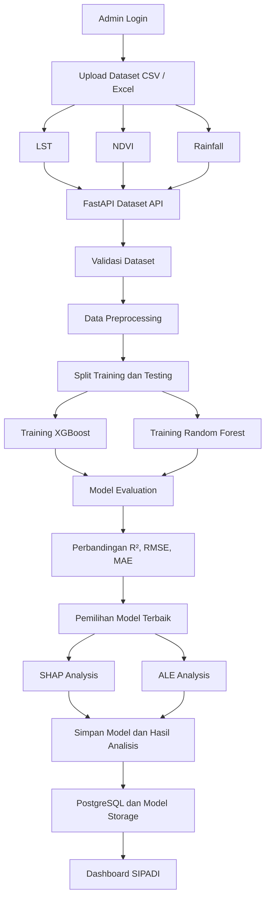

# Implementasi 15 — Arsitektur Backend ML, Pipeline XAI, dan Integrasi PostgreSQL

Dokumen ini mencatat analisis komparatif antara workspace utama SIPADI dengan repositori `sc-sipadi`, pemetaan diagram alir arsitektur sistem, serta rencana implementasi integrasi backend FastAPI, pelatihan model (XGBoost vs Random Forest), Explainable AI (SHAP & ALE), dan basis data PostgreSQL.

---

## 1. Analisis Komparatif: Workspace Aktif vs `sc-sipadi`

### 1.1 Status Repositori
- **Workspace Aktif (`web project`):**
  - Frontend React 19 + TypeScript + Vite + Tailwind CSS yang telah dipoles dengan desain minimalis, interaktif, dan modern.
  - Landing page memiliki animasi penambahan angka (counter) pada metrik hero, navbar mengambang yang persisten saat digulir, kartu "MENGAPA SIPADI" dengan ikon di tengah dan efek hover-expand tanpa badge yang mengganggu, alur kerja bernomor terpusat (`01`–`04`) tanpa kata "Tahap", section Explainable AI berwarna hijau gelap solid tanpa garis tepi neon kecil, serta accordion FAQ satu terbuka.
  - Menggunakan simulasi mock data di [`src/services/apiService.ts`](file:///c:/Users/iputu/Documents/Kuliah/Semester%205/Sistem%20Cerdas%20(B)/web%20project/src/services/apiService.ts) dan [`src/mocks/data.ts`](file:///c:/Users/iputu/Documents/Kuliah/Semester%205/Sistem%20Cerdas%20(B)/web%20project/src/mocks/data.ts).
  - Belum memiliki folder `backend/`, modul Python, maupun halaman antarmuka Admin Dataset.

- **Repositori Paralel (`sc-sipadi\sc-sipadi`):**
  - Merupakan cabang pengerjaan paralel yang telah menambahkan prototipe backend Python FastAPI (`backend/main.py`), pustaka machine learning (`requirements.txt`), artefak dataset historis padi Bali 2018–2025 (`847 baris`), serta file basis data SQLite (`sipadi.db`).
  - Menambahkan halaman antarmuka frontend [`AdminPage.tsx`](file:///c:/Users/iputu/Documents/Kuliah/Semester%205/Sistem%20Cerdas%20(B)/web%20project/sc-sipadi/sc-sipadi/src/pages/AdminPage.tsx) untuk mengunggah CSV/Excel dan memicu pelatihan model machine learning secara langsung.
  - Memperbarui sidebar dengan rute `/dashboard/admin` dan memperbarui `apiService.ts` untuk mencoba mengambil data pelatihan dari `http://localhost:8000/api/runs/latest`.
  - **Kekurangan pada `sc-sipadi`:**
    1. Menggunakan basis data **SQLite** (`sipadi.db`), padahal diagram arsitektur sistem menargetkan **PostgreSQL**.
    2. Endpoint upload dataset dan halaman admin belum diamankan dengan autentikasi Admin sungguhan.
    3. Validasi dataset masih bersifat minimal (hanya memeriksa ekstensi file dan jumlah baris $\ge 20$), belum memvalidasi rentang fisik fitur spasial (NDVI, LST, Curah Hujan).
    4. Antarmuka landing page belum memiliki penyempurnaan UI/UX terkini yang sudah diterapkan di workspace utama.

---

## 2. Pemetaan Diagram Alir Arsitektur Sistem

Arsitektur sistem dibangun secara ketat mengikuti diagram alir yang telah dirancang:

### Tahapan Alur Kerja:
1. **Admin Login:** Otentikasi dan otorisasi pengguna dengan hak akses administrator sebelum dapat mengakses fungsi upload dataset dan manajemen model.
2. **Upload Dataset CSV / Excel:** Admin mengunggah berkas tabular yang memuat data agroklimat dan penginderaan jauh:
   - **LST (Land Surface Temperature):** Suhu permukaan tanah (°C).
   - **NDVI (Normalized Difference Vegetation Index):** Indeks vegetasi kanopi tanaman padi ($[-1.0, 1.0]$).
   - **Rainfall:** Curah hujan kumulatif (mm).
   - **Produktivitas:** Nilai target hasil panen padi (kuintal/ha atau ton/ha).
3. **FastAPI Dataset API:** Server backend menerima berkas via multipart form upload (`/api/admin/datasets/upload`).
4. **Validasi Dataset:** Memeriksa kelengkapan kolom wajib, tipe data numerik, ketiadaan baris kosong ekstrem, serta batas nilai fisik wajar.
5. **Data Preprocessing:** Imputasi nilai hilang (mean/median), pembersihan outlier tak berhingga (`inf`), dan standarisasi penamaan kolom.
6. **Split Training dan Testing:** Pembagian data secara acak terdistribusi (misal 80% train, 20% test dengan `random_state` terkunci untuk reproduktibilitas).
7. **Dual Training Paralel:**
   - **XGBoost Regressor:** Algoritma gradient boosted decision trees.
   - **Random Forest Regressor:** Algoritma ensemble bagging decision trees.
8. **Model Evaluation & Metric Comparison:** Menghitung metrik performa regresi:
   - Koefisien Determinasi ($R^2$)
   - Root Mean Squared Error ($RMSE$)
   - Mean Absolute Error ($MAE$)
9. **Pemilihan Model Terbaik:** Membandingkan nilai $R^2$ pengujian tertinggi untuk menentukan model pemenang yang akan diproduksi.
10. **Explainable AI (SHAP & ALE Analysis):**
    - **SHAP (SHapley Additive exPlanations):** Menggunakan `TreeExplainer` untuk menghitung kontribusi marjinal tiap fitur.
    - **ALE (Accumulated Local Effects):** Menghitung isolasi pengaruh nonlinier tiap fitur tanpa bias korelasi antarfaktor.
11. **Penyimpanan Hasil:** Menyimpan bobot model serial (`.joblib`), metadata pelatihan, matriks evaluasi, serta hasil SHAP & ALE.
12. **PostgreSQL & Model Storage:** Data terstruktur dan log metrik disimpan ke basis data PostgreSQL, sedangkan berkas model biner disimpan di storage lokal/cloud.
13. **Dashboard SIPADI:** Antarmuka web menyajikan visualisasi analitik interaktif, kurva respons ALE, kontribusi SHAP, dan prediksi produktivitas secara real-time.

---

## 3. Rencana Aksi Implementasi (To-Do List)

- [ ] **Fase 1: Penyatuan Kode (Monorepo Integration)**
  - Memindahkan kode backend dari `sc-sipadi/sc-sipadi/backend` ke folder root [`backend/`](file:///c:/Users/iputu/Documents/Kuliah/Semester%205/Sistem%20Cerdas%20(B)/web%20project/backend).
  - Memindahkan komponen [`AdminPage.tsx`](file:///c:/Users/iputu/Documents/Kuliah/Semester%205/Sistem%20Cerdas%20(B)/web%20project/src/pages/AdminPage.tsx) ke workspace aktif dan menyematkan rutenya di `App.tsx` serta menu sidebar `AppSidebar.tsx`.
- [ ] **Fase 2: Konfigurasi Basis Data PostgreSQL**
  - Membuat lapisan abstraksi database (SQLAlchemy / asyncpg / psycopg2) yang mendukung PostgreSQL dan fallback lokal.
  - Merancang tabel `users` (admin auth), `training_runs` (riwayat model & metrik), dan `dataset_records` (penyimpanan baris tabular LST, NDVI, Curah Hujan).
- [ ] **Fase 3: Peningkatan Pipeline Machine Learning & Validasi**
  - Menambahkan modul validasi schema khusus untuk LST, NDVI, Rainfall, dan Produktivitas.
  - Memperkaya komputasi evaluasi model ($R^2$, $RMSE$, $MAE$) dan perhitungan kurva ALE yang lebih stabil.
  - Menyediakan endpoint inferensi (`POST /api/predict`) untuk menerima nilai kustom NDVI, LST, Curah Hujan.
- [ ] **Fase 4: Integrasi Frontend API Service**
  - Memperbarui [`src/services/apiService.ts`](file:///c:/Users/iputu/Documents/Kuliah/Semester%205/Sistem%20Cerdas%20(B)/web%20project/src/services/apiService.ts) agar memanggil backend FastAPI secara live dengan graceful fallback ke mock data jika backend tidak aktif.
  - Memastikan antarmuka Admin Page memiliki umpan balik visual (progress bar, notifikasi sukses/gagal, ringkasan metrik).

