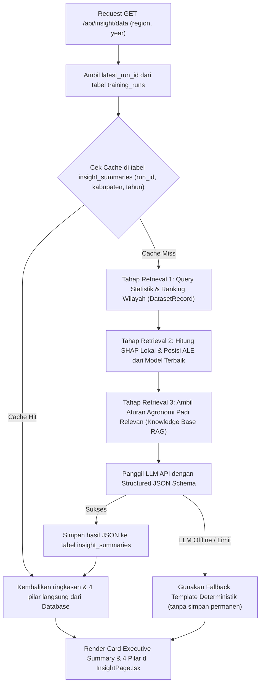

# Implementasi 16 — Arsitektur Structured RAG & Database Caching untuk Halaman Insight & Peta

Dokumen ini merancang arsitektur integrasi kecerdasan buatan (**Data-Grounded Structured RAG + Persistent Database Cache**) pada halaman **Insight & Peta** ([`InsightPage.tsx`](file:///c:/Users/iputu/Documents/Kuliah/Semester%205/Sistem%20Cerdas%20(B)/web%20project/src/pages/InsightPage.tsx)), sehingga AI menghasilkan ringkasan eksekutif dan 4 pilar kesimpulan secara kontekstual tanpa antarmuka chatbot, lalu menyimpannya di database agar tidak perlu memanggil ulang LLM untuk kombinasi wilayah dan tahun yang sama.

---

## 1. Latar Belakang & Masalah Saat Ini

Pada kondisi kode saat ini:
- Kartu **Sintesis Status Panen Wilayah** di [`InsightPage.tsx`](file:///c:/Users/iputu/Documents/Kuliah/Semester%205/Sistem%20Cerdas%20(B)/web%20project/src/pages/InsightPage.tsx#L76-L108) masih memakai string template statis yang disusun langsung di endpoint `GET /api/insight/data` ([`backend/main.py`](file:///c:/Users/iputu/Documents/Kuliah/Semester%205/Sistem%20Cerdas%20(B)/web%20project/backend/main.py#L476)).
- Empat kartu pilar di bagian **KESIMPULAN SECARA KESELURUHAN** ([`InsightPage.tsx`](file:///c:/Users/iputu/Documents/Kuliah/Semester%205/Sistem%20Cerdas%20(B)/web%20project/src/pages/InsightPage.tsx#L179-L223))—yaitu *Evaluasi Panen*, *Kondisi Biofisik*, *Validasi XAI*, dan *Aksi Lapangan*—masih berisi paragraf statis yang identik meskipun filter wilayah dan tahun diubah.

Dengan menerapkan **Structured RAG (Retrieval-Augmented Generation)** berbasis cache database:
1. AI bekerja secara otomatis (*headless*) di backend dan langsung mengisi slot card UI menggunakan format JSON terstruktur.
2. Seluruh angka tetap bersumber 100% dari database (`DatasetRecord`) dan komputasi XAI (`TrainingRun` + `shap.TreeExplainer`), sehingga AI **tidak berhalusinasi angka**.
3. Narasi yang sudah dibuat disimpan permanen per `(run_id, kabupaten, tahun)`, sehingga permintaan berikutnya langsung dilayani instan dari database tanpa memanggil API LLM berulang kali.

---

## 2. Arsitektur Alur Kerja (Cache-First + Structured RAG)



---

## 3. Rancangan Skema Database (`backend/models.py`)

Tambahkan model tabel `InsightSummary` pada [`backend/models.py`](file:///c:/Users/iputu/Documents/Kuliah/Semester%205/Sistem%20Cerdas%20(B)/web%20project/backend/models.py) dengan relasi *cascade* ke [`TrainingRun`](file:///c:/Users/iputu/Documents/Kuliah/Semester%205/Sistem%20Cerdas%20(B)/web%20project/backend/models.py#L19-L36):

```python
from sqlalchemy import UniqueConstraint

class InsightSummary(Base):
    __tablename__ = "insight_summaries"
    __table_args__ = (
        UniqueConstraint("run_id", "kabupaten", "tahun", name="uq_insight_run_region_year"),
    )

    id = Column(Integer, primary_key=True, autoincrement=True)
    run_id = Column(String(64), ForeignKey("training_runs.id", ondelete="CASCADE"), index=True, nullable=False)
    kabupaten = Column(String(100), index=True, nullable=False)
    tahun = Column(Integer, index=True, nullable=False)

    # Konten Card Executive Summary
    headline_summary = Column(Text, nullable=False)
    harvest_category_note = Column(Text, nullable=False)

    # Konten 4 Pilar Card Kesimpulan Secara Keseluruhan
    evaluasi_panen = Column(Text, nullable=False)
    kondisi_biofisik = Column(Text, nullable=False)
    validasi_xai = Column(Text, nullable=False)
    aksi_lapangan = Column(Text, nullable=False)

    # Metadata Audit & Cache
    generated_by = Column(String(80), nullable=False, default="gemini-3.5-flash-lite")  # Contoh: "gemini-3.5-flash-lite" / "template-fallback"
    created_at = Column(DateTime, default=datetime.utcnow)

    run = relationship("TrainingRun")
```

### Keuntungan Pengikatan ke `run_id`:
- **Otomatis Invalidasi Saat Dataset Baru Diunggah:** Ketika admin mengunggah file CSV/Excel baru melalui [`AdminPage.tsx`](file:///c:/Users/iputu/Documents/Kuliah/Semester%205/Sistem%20Cerdas%20(B)/web%20project/src/pages/AdminPage.tsx), backend membuat `run_id` baru. Otomatis seluruh ringkasan untuk dataset lama tidak akan tercampur dengan hasil pelatihan model baru.
- **Kapasitas Maksimal Terkendali:** Untuk 9 kabupaten/kota $\times$ 8 tahun (2018–2025), maksimal hanya tersimpan 72 baris per `TrainingRun`. Setelah satu wilayah-tahun dibuka sekali, akses oleh seluruh pengguna (lokal maupun via ngrok) langsung menjadi *Cache Hit*.

---

## 4. Rancangan Knowledge Base RAG Agronomi

Agar analisis AI tidak bersifat generik melainkan relevan dengan kondisi lahan sawah Bali dan indikator satelit SIPADI, sediakan direktori `backend/knowledge/` berisi aturan agronomis berbasis ambang batas fitur (*rule-grounded knowledge chunks*):

| Kategori Konteks | Kondisi Pemicu Retrieval | Pengetahuan yang Disuntikkan ke Prompt |
|---|---|---|
| **Vegetasi Kanopi (NDVI)** | NDVI < 0.55 vs 0.55–0.70 vs > 0.75 | Interpretasi indeks klorofil fase vegetatif/primordia, titik saturasi kanopi ALE (> 0.75), serta rekomendasi pemupukan N/NPK berimbang. |
| **Stres Termal (LST)** | LST < 26°C vs 26–30°C vs > 30°C | Risiko penurunan laju pengisian bulir (*heat stress*) di atas 30°C dan strategi penggenangan terputus (*intermittent irrigation*). |
| **Hidrologi (Rainfall)** | Rendah (< 10.000 mm) vs Sedang vs Tinggi (> 18.000 mm) | Pengaturan giliran air irigasi pada defisit air, serta inspeksi drainase tersier & pencegahan penyakit blas/jamur saat kelembapan tinggi. |
| **Tipologi Agroekologi Bali** | Dataran tinggi (Bangli, bagian utara Tabanan/Karangasem) vs Dataran rendah irigasi teknis (Badung, Gianyar, Denpasar) | Penyesuaian rekomendasi varietas (misal padi beras merah dataran tinggi vs Inpari/Ciherang dataran rendah) dan kontur elevasi lahan. |

Backend melakukan *context retrieval* secara deterministik berdasarkan nilai terukur kabupaten tersebut (dapat pula diperluas dengan *vector embedding* apabila korpus dokumen penyuluhan pertanian bertambah banyak).

---

## 5. Kontrak JSON Terstruktur & Integrasi API

### 5.1 Skema Output LLM (Structured Output)
Backend mengirim payload konteks kuantitatif (statistik kabupaten, delta YoY, peringkat provinsi, nilai SHAP lokal, titik observasi ALE) + potongan Knowledge Base ke LLM dengan paksaan skema JSON berikut:

```json
{
  "headlineSummary": "Ringkasan 1-2 kalimat eksekutif yang memuat angka produktivitas, status kategori, dan faktor penentu utama wilayah pada tahun terpilih.",
  "harvestCategoryNote": "Catatan komparatif terhadap median provinsi Bali dan tren tahun sebelumnya.",
  "conclusion": {
    "evaluasiPanen": "Analisis capaian produktivitas wilayah, peringkat komparatif antar-kabupaten, dan fluktuasi bulanan (Jan-Des).",
    "kondisiBiofisik": "Analisis sinergi NDVI, suhu permukaan LST, dan pasokan curah hujan berdasarkan data observasi aktual.",
    "validasiXai": "Penjelasan penalaran model terbaik berdasarkan kontribusi positif/negatif nilai SHAP dan posisi kurva ALE.",
    "aksiLapangan": "Rekomendasi teknis konkret untuk petugas lapangan/petani (irigasi, drainase, pemupukan, atau adaptasi suhu)."
  }
}
```

### 5.2 Spesifikasi Model & Integrasi SDK (`google-genai`)
Integrasi menggunakan SDK resmi Google Gemini (**`google-genai`**) dengan model **`gemini-3.5-flash-lite`** yang mendukung penuh *Structured Outputs* pada **Free Tier** Google AI Studio, memiliki latensi rendah, dan efisien untuk *pre-warming* maupun *lazy caching*:

```python
from google import genai
from google.genai import types
from pydantic import BaseModel

class ConclusionSchema(BaseModel):
    evaluasiPanen: str
    kondisiBiofisik: str
    validasiXai: str
    aksiLapangan: str

class InsightSynthesisSchema(BaseModel):
    headlineSummary: str
    harvestCategoryNote: str
    conclusion: ConclusionSchema

client = genai.Client()  # Membaca GEMINI_API_KEY dari environment
response = client.models.generate_content(
    model="gemini-3.5-flash-lite",
    contents=grounded_prompt,
    config=types.GenerateContentConfig(
        temperature=0.25,
        response_mime_type="application/json",
        response_schema=InsightSynthesisSchema,
    ),
)
```

### 5.3 Pembaruan Kontrak Frontend ([`src/types/index.ts`](file:///c:/Users/iputu/Documents/Kuliah/Semester%205/Sistem%20Cerdas%20(B)/web%20project/src/types/index.ts))
Tambahkan properti opsional `conclusion` dan `aiMeta` pada interface [`InsightData`](file:///c:/Users/iputu/Documents/Kuliah/Semester%205/Sistem%20Cerdas%20(B)/web%20project/src/types/index.ts#L99-L112):

```typescript
export interface InsightConclusion {
  evaluasiPanen: string;
  kondisiBiofisik: string;
  validasiXai: string;
  aksiLapangan: string;
}

export interface InsightData {
  // ...field yang sudah ada
  conclusion?: InsightConclusion;
  aiMeta?: {
    cached: boolean;
    generatedBy: string;
    generatedAt?: string;
  };
}
```

Pada [`InsightPage.tsx`](file:///c:/Users/iputu/Documents/Kuliah/Semester%205/Sistem%20Cerdas%20(B)/web%20project/src/pages/InsightPage.tsx#L179-L223), keempat pilar me-render `data.conclusion?.evaluasiPanen`, `data.conclusion?.kondisiBiofisik`, `data.conclusion?.validasiXai`, dan `data.conclusion?.aksiLapangan` dengan *fallback* ke teks bawaan apabila field belum tersedia.

---

## 6. Strategi Eksekusi & Ketahanan Sistem

1. **Lazy Caching (On-Demand):** Ringkasan AI hanya dibuat saat pasangan `(kabupaten, tahun)` pertama kali dibuka di halaman **Insight & Peta**, lalu langsung disimpan ke tabel `insight_summaries`.
2. **Opsional Pre-Warming / Regenerate:** Admin dapat diberi parameter query opsional `?refresh=true` (dilindungi autentikasi admin) jika ingin me-regenerate narasi untuk suatu wilayah/tahun tanpa harus mengunggah ulang dataset.
3. **Konfigurasi Environment ([`backend/.env.example`](file:///c:/Users/iputu/Documents/Kuliah/Semester%205/Sistem%20Cerdas%20(B)/web%20project/backend/.env.example)):**
   - Tambahkan `GEMINI_API_KEY=` dan `GEMINI_MODEL=gemini-3.5-flash-lite`.
   - Tambahkan `google-genai` ke [`backend/requirements.txt`](file:///c:/Users/iputu/Documents/Kuliah/Semester%205/Sistem%20Cerdas%20(B)/web%20project/backend/requirements.txt).
   - Jika `GEMINI_API_KEY` kosong atau layanan eksternal tidak terjangkau, sistem otomatis menggunakan *deterministic fallback generator* berbasis data aktual tanpa menulis status fallback ke cache permanen.

---

## 7. Rencana Aksi Implementasi (To-Do List)

- [ ] **Fase 1: Skema Database, Dependencies & Knowledge Base**
  - Menambahkan tabel `InsightSummary` ke [`backend/models.py`](file:///c:/Users/iputu/Documents/Kuliah/Semester%205/Sistem%20Cerdas%20(B)/web%20project/backend/models.py), paket `google-genai` ke `requirements.txt`, serta konfigurasi `GEMINI_API_KEY` & `GEMINI_MODEL=gemini-3.5-flash-lite` di `.env`.
  - Membuat modul `backend/rag_engine.py` beserta korpus aturan agronomi padi di `backend/knowledge/`.
- [ ] **Fase 2: Pipeline Retrieval + Structured Gemini Synthesis**
  - Menghubungkan `rag_engine.py` dengan query statistik wilayah, `shap.TreeExplainer`, dan data ALE dari [`backend/main.py`](file:///c:/Users/iputu/Documents/Kuliah/Semester%205/Sistem%20Cerdas%20(B)/web%20project/backend/main.py).
  - Mengimplementasikan logika *cache-first* (`SELECT` $\rightarrow$ jika kosong panggil `gemini-3.5-flash-lite` dengan `response_schema` + `INSERT`) dan mekanisme *fallback* saat offline.
- [ ] **Fase 3: Integrasi Frontend `InsightPage`**
  - Memperbarui [`src/types/index.ts`](file:///c:/Users/iputu/Documents/Kuliah/Semester%205/Sistem%20Cerdas%20(B)/web%20project/src/types/index.ts), [`src/services/apiService.ts`](file:///c:/Users/iputu/Documents/Kuliah/Semester%205/Sistem%20Cerdas%20(B)/web%20project/src/services/apiService.ts), dan 4 pilar card pada [`InsightPage.tsx`](file:///c:/Users/iputu/Documents/Kuliah/Semester%205/Sistem%20Cerdas%20(B)/web%20project/src/pages/InsightPage.tsx) agar menampilkan hasil sintesis AI secara dinamis.
