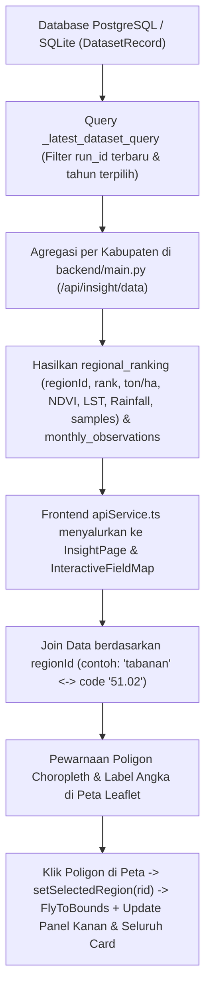

# Implementasi 17 — Peta Satelit Interaktif Bali (Leaflet + GeoJSON 9 Kabupaten)

Dokumen ini menjelaskan arsitektur teknis, sumber koordinat geografis, pustaka (*library*) yang digunakan, serta mekanisme pemetaan data riil ke atas peta interaktif pada halaman **Insight & Peta Lahan** ([`InsightPage.tsx`](file:///c:/Users/iputu/Documents/Kuliah/Semester%205/Sistem%20Cerdas%20(B)/web%20project/src/pages/InsightPage.tsx) dan [`InteractiveFieldMap.tsx`](file:///c:/Users/iputu/Documents/Kuliah/Semester%205/Sistem%20Cerdas%20(B)/web%20project/src/components/common/InteractiveFieldMap.tsx)).

---

## 1. Library & Penyedia Peta (*Basemap Providers*)

### 1.1 Library Utama
- **`leaflet` (`^1.9.4`) & `@types/leaflet` (`^1.9.22`)** pada [`package.json`](file:///c:/Users/iputu/Documents/Kuliah/Semester%205/Sistem%20Cerdas%20(B)/web%20project/package.json):
  - Pustaka GIS web *open-source* yang ringan, mendukung *hardware-accelerated* pan/zoom, rendering GeoJSON vektor, dan tidak memerlukan API key berbayar maupun kartu kredit.
  - Diintegrasikan langsung menggunakan React `useRef` + `useEffect` (tanpa wrapper pihak ketiga) agar kompatibel penuh dengan **React 19** tanpa konflik *peer dependency*.

### 1.2 Layer Peta Dasar (*Tile Providers*)
Pengguna dapat berpindah mode peta secara instan melalui sakelar di pojok kanan atas peta:
1. **Mode Citra Satelit (*Default*):**
   - **Esri World Imagery** (`server.arcgisonline.com/ArcGIS/rest/services/World_Imagery`) untuk menampilkan citra udara/satelit nyata Pulau Bali (hamparan sawah, garis pantai, gunung, dan sungai terlihat langsung).
   - Dilapisi overlay **Esri World Boundaries and Places** (`Reference/World_Boundaries_and_Places`) agar nama kecamatan, kota, dan batas wilayah tetap terbaca di atas citra satelit.
2. **Mode Peta Jalan:**
   - **OpenStreetMap (`tile.openstreetmap.org`)** untuk tampilan peta jalan standar yang lebih ringan dan kontras tinggi.

---

## 2. Sumber Titik Koordinat, Luas Wilayah & Batas Geografis

Bentuk poligon dan luas geografis ke-9 Kabupaten/Kota di Bali **tidak digambar manual**, melainkan menggunakan data batas administratif nyata yang dibundel lokal di [`src/data/baliRegencies.json`](file:///c:/Users/iputu/Documents/Kuliah/Semester%205/Sistem%20Cerdas%20(B)/web%20project/src/data/baliRegencies.json) (~27,9 KB).

### 2.1 Asal & Format Data GeoJSON
- **Sumber:** Repositori terbuka batas administratif Indonesia (`AlfianAliM/Indonesia-GeoJSON`, berdasarkan batas wilayah BPS/Kemendagri), yang disaring khusus untuk kode wilayah Provinsi Bali berawalan **`51.`** (`FeatureCollection` berisi 9 fitur).
- **Sistem Koordinat:** **WGS 84 (`EPSG:4326`)**, di mana setiap fitur memiliki geometri `Polygon` atau `MultiPolygon` berisi susunan koordinat lintang dan bujur asli (`[longitude, latitude]`), misalnya koordinat ujung selatan Badung sekitar `[115.1252, -8.8476]`.
- **Daftar 9 Fitur Wilayah dalam `baliRegencies.json`:**

| Kode Wilayah | Nama Resmi di GeoJSON | `regionId` Penghubung SIPADI |
| :--- | :--- | :--- |
| `51.01` | Kabupaten Jembrana | `jembrana` |
| `51.02` | Kabupaten Tabanan | `tabanan` |
| `51.03` | Kabupaten Badung | `badung` |
| `51.04` | Kabupaten Gianyar | `gianyar` |
| `51.05` | Kabupaten Klungkung | `klungkung` |
| `51.06` | Kabupaten Bangli | `bangli` |
| `51.07` | Kabupaten Karangasem | `karangasem` |
| `51.08` | Kabupaten Buleleng | `buleleng` |
| `51.71` | Kota Denpasar | `denpasar` |

### 2.2 Bagaimana Luas Zoom & Titik Tengah Label Dihitung?
1. **Luas & Batas Zoom Otomatis (`getBounds` & `flyToBounds`):**
   - Saat Leaflet memuat GeoJSON melalui `L.geoJSON(...)`, setiap poligon kabupaten otomatis memiliki kotak pembatas geografis asli (`featureLayer.getBounds()`).
   - Ketika kabupaten dipilih, fungsi `map.flyToBounds(selectedBounds, { padding: [36, 36], maxZoom: 11 })` menggerakkan kamera dan menyesuaikan level *zoom* secara proporsional dengan luas geografis aslinya (contoh: **Buleleng** yang luas otomatis di-*zoom* lebih lebar dibanding **Kota Denpasar**).
   - Tombol **"Seluruh Bali"** mengembalikan viewport ke `BALI_BOUNDS` (`[-8.86, 114.42]` hingga `[-8.05, 115.72]`).
2. **Titik Koordinat Lencana Angka (*Centroid*):**
   - Titik pusat tiap lencana (`Badung 6.86`, `Tabanan 6.09`, dll.) dihitung otomatis menggunakan titik tengah batas poligon (`polyBounds.getCenter()`).
   - Khusus **Badung** yang bentuk geografisnya memanjang dari selatan ke utara dan sangat rapat dengan Kota Denpasar, titik labelnya digeser sedikit ke utara (`center.lat + 0.04, center.lng - 0.01`) agar kedua lencana tetap terbaca tanpa tumpang tindih.

---

## 3. Cara Kerja Pemetaan Data Riil ke Wilayah (*Data Join & Choropleth*)

Seluruh angka pada peta berasal langsung dari tabel `dataset_records` (file [`dataset_padi_bali_ML_2018_2025.csv`](file:///c:/Users/iputu/Documents/Kuliah/Semester%205/Sistem%20Cerdas%20(B)/web%20project/backend/data/dataset_padi_bali_ML_2018_2025.csv)) tanpa data simulasi/fiktif:

### 3.1 Tahap Backend ([`backend/main.py`](file:///c:/Users/iputu/Documents/Kuliah/Semester%205/Sistem%20Cerdas%20(B)/web%20project/backend/main.py))
1. **Isolasi Dataset Aktif (`_latest_dataset_query`):**
   - Query disaring ke `run_id` milik `TrainingRun` paling baru agar unggahan dataset berulang oleh admin tidak menduplikasi jumlah baris (memastikan tiap kabupaten tepat memiliki `12` catatan observasi bulanan per tahun).
2. **Standardisasi ID Wilayah (`_to_region_id`):**
   - Nama kolom `Kabupaten` dari database (misal `"Kota Denpasar"` atau `"Tabanan"`) dinormalisasi menjadi `regionId` (`"denpasar"`, `"tabanan"`), sehingga cocok 1-banding-1 dengan properti `regionId` di `baliRegencies.json`.
3. **Output Real Data:**
   - **`regional_ranking`**: Data statistik rata-rata produktivitas (`ton/ha`), `NDVI`, `LST`, `Rainfall`, jumlah sampel, dan peringkat (`#1` s.d. `#9`) seluruh kabupaten pada tahun terpilih.
   - **`monthly_observations`**: Rincian riil 12 bulan (`Jan` s.d. `Des`) untuk kabupaten dan tahun terpilih yang ditampilkan pada tabel catatan bulanan di panel kanan peta.

### 3.2 Logika Pewarnaan Poligon (*Choropleth Scale*)
Setiap poligon kabupaten diwarnai berdasarkan `avgProductivityTonHa` pada tahun tersebut oleh fungsi `getYieldColor` di [`InteractiveFieldMap.tsx`](file:///c:/Users/iputu/Documents/Kuliah/Semester%205/Sistem%20Cerdas%20(B)/web%20project/src/components/common/InteractiveFieldMap.tsx#L30-L36):

| Rentang Produktivitas Aktual | Warna Fill Poligon | Interpretasi Visual |
| :--- | :--- | :--- |
| **$\ge 6.2$ ton/ha** | `#1B6B3A` *(Hijau Zamrud Pekat)* | Produktivitas sangat tinggi |
| **$5.8 - 6.1$ ton/ha** | `#287A4A` *(Hijau Hutan)* | Produktivitas tinggi |
| **$5.2 - 5.7$ ton/ha** | `#55A85F` *(Hijau Daun)* | Produktivitas optimal / menengah |
| **$< 5.2$ ton/ha** | `#D97706` *(Oranye Amber)* | Relatif lebih rendah / perlu perhatian |

- Poligon kabupaten yang sedang aktif diberi border terang `#CFEF8A` (ketebalan `3.5px`) dan transparansi `fillOpacity: 0.42` agar citra sawah di bawahnya tetap terlihat jelas.

---

## 4. Sinkronisasi Interaksi & Tata Letak UI

1. **Sinkronisasi Dua Arah dengan Header:**
   - Mengklik poligon kabupaten di peta (atau tombol peringkat `#1`–`#9` di bawah peta) memanggil `setSelectedRegion(regionId)` milik `FilterContext`, sehingga dropdown **Wilayah** di header, kartu ringkasan, faktor penentu, 4 pilar kesimpulan, dan peta semuanya otomatis berganti ke kabupaten tersebut.
2. **Isolasi Layer CSS (`relative z-0 isolate`):**
   - Leaflet secara bawaan memberi `z-index` `200`–`700` pada pane peta dan kontrol zoom. Dengan membungkus kontainer Leaflet dalam `relative z-0 isolate`, seluruh layer Leaflet dikurung di *stacking context* lokal sehingga tidak pernah menutupi `AppHeader` (`z-40`) maupun `AppSidebar` (`z-50`) saat halaman digulir.
3. **Kejujuran Granularitas Data:**
   - Karena dataset historis [`dataset_padi_bali_ML_2018_2025.csv`](file:///c:/Users/iputu/Documents/Kuliah/Semester%205/Sistem%20Cerdas%20(B)/web%20project/backend/data/dataset_padi_bali_ML_2018_2025.csv) dicatat pada tingkat **Kabupaten/Kota per Bulan**, peta secara akurat memetakan data pada level poligon Kabupaten/Kota disertai catatan bulanan Jan–Des yang riil, bukan memecahnya menjadi petak sawah simulasi.
